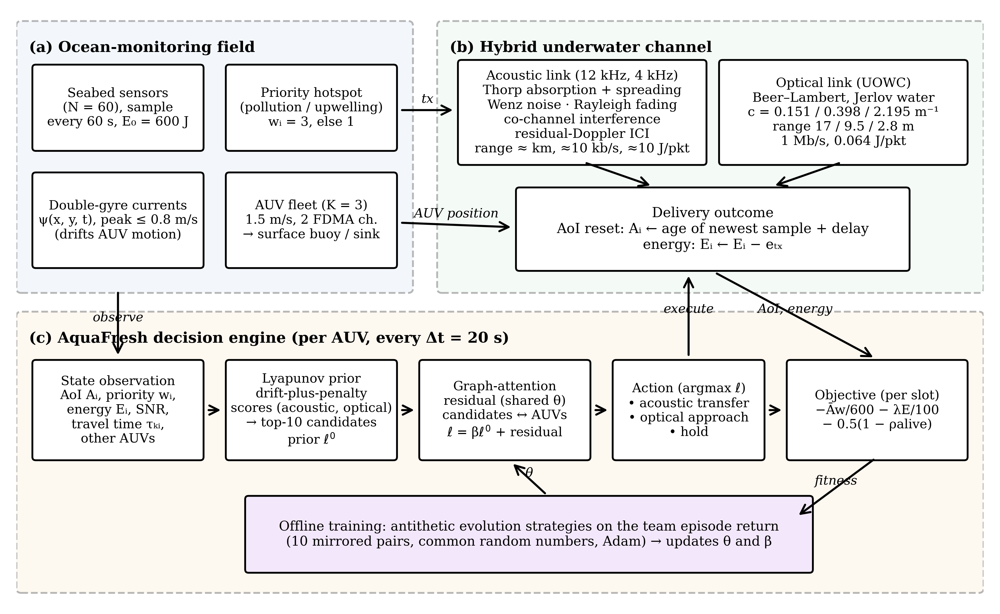

# AquaFresh

Official implementation of the paper

> **Minimizing Information Age and Sensor Energy in Ocean Monitoring Networks through Hybrid Acoustic and Optical Data Harvesting by Cooperative Underwater Vehicles**
> Marisargunam S and Arul Dalton G
> Submitted to *Journal of Ocean Engineering and Marine Energy* (Springer)

AquaFresh is a cooperative policy for multiple autonomous underwater vehicles (AUVs) that harvest data from seabed ocean monitoring sensors. In every 20 s slot each AUV decides **which sensor to serve** and **whether to use an acoustic link** (long range, slow, energy costly) **or an optical link** (short range, fast, energy cheap). The goal is to minimise priority-weighted **age of information (AoI)** and **sensor energy**. The policy combines Lyapunov drift-plus-penalty scores with a graph attention residual shared by all AUVs, and it is trained with antithetic **evolution strategies**.



## Highlights

* Physically grounded simulator:
  * acoustic link with Thorp absorption, Wenz ambient noise, Rayleigh fading, co-channel interference and residual Doppler;
  * optical link with Beer–Lambert attenuation for Jerlov water types;
  * time-varying double-gyre ocean currents.
* Four baselines: nearest-node acoustic, TSP optical tour, AoI-greedy hybrid and Lyapunov max-weight.
* A cooperative multi-agent PPO (MAPPO) implementation is included for transparency; in the paper it did not improve on its initialisation.
* Pretrained models for every configuration reported in the paper, plus scripts that reproduce all tables and figures.

## Results (10 held-out ocean realisations)

| Policy | Weighted AoI (s) | Sensor energy (J/sensor/h) | Delivered packets | Optical share | Return |
|---|---|---|---|---|---|
| Greedy-NN (acoustic) | 1713 | 114.6 | 395 | 0% | -551.8 |
| TSP tour (optical) | 1154 | 0.1 | 80 | 100% | -346.3 |
| AoI-greedy hybrid | 587 | 94.5 | 362 | 25% | -204.4 |
| Lyapunov max-weight | 483 | 131.4 | 244 | 15% | -184.8 |
| Prior only (untrained) | 579 | 33.6 | 190 | 10% | -183.7 |
| AquaFresh | 423 ± 18 | 93.5 ± 6.9 | 271 ± 7 | 7% | -154.8 ± 3.7 |

AquaFresh values are mean ± std over 3 training seeds. Full ablations, the AoI–energy sweep and zero-shot generalisation results are in `results/results.json` and the paper.

## Repository structure

```
AquaFresh/
├── aquafresh/               # core package
│   ├── env.py               # ocean environment: channels, currents, AoI, energy
│   ├── baselines.py         # Greedy-NN, TSP optical tour, AoI-greedy, Lyapunov max-weight
│   ├── mappo.py             # graph-attention network + cooperative MAPPO baseline (JAX)
│   ├── es.py                # AquaFresh policy and evolution-strategies training
│   ├── evaluate.py          # evaluation utilities
│   └── paths.py             # model / results / figure directories
├── scripts/
│   ├── train.py             # train AquaFresh or an ablation
│   ├── evaluate_baselines.py
│   ├── reproduce_results.py # all tables (results.json) and figures
│   ├── attention_scaling.py # zero-shot scaling test (N = 100, K = 5)
│   └── make_block_diagram.py
├── models/                  # pretrained policies (.pkl)
├── results/                 # results.json, scal.json
├── figures/                 # figures used in the paper (600 dpi)
└── tests/test_smoke.py
```

## Installation

Requires Python 3.10 or newer. A CPU is sufficient.

```bash
git clone https://github.com/GArulDalton/AquaFresh.git
cd AquaFresh
pip install -r requirements.txt
python tests/test_smoke.py          # about 30 s
```

## Usage

**Evaluate the baselines**
```bash
python scripts/evaluate_baselines.py
```

**Train AquaFresh** (≈5–8 min per seed on one CPU core)
```bash
python scripts/train.py aquafresh --seeds 0,1,2 --gens 50
```

Ablations and energy-weight sweep (configuration names as in the paper):

| Config | Meaning |
|---|---|
| `no_attn` | without graph attention |
| `no_prior` | without Lyapunov prior |
| `no_hybrid` | acoustic links only |
| `no_cur` | without current awareness |
| `af_l0`, `af_l2` | energy weight λ = 0 and λ = 2 |

```bash
python scripts/train.py no_attn --seeds 0,1 --gens 40
```

**Reproduce the tables and figures**
```bash
python scripts/reproduce_results.py               # figures from results/results.json
python scripts/reproduce_results.py --recompute   # re-evaluate every policy (~10 min)
python scripts/attention_scaling.py
```

Evaluation uses fixed held-out seeds 100–109, so the pretrained models reproduce the reported numbers exactly; for example, AquaFresh's mean weighted AoI is 422.59 s.

## Citation

If you use this code, please cite the paper (citation details will be updated on publication):

```bibtex
@article{marisargunam2026aquafresh,
  title   = {Minimizing Information Age and Sensor Energy in Ocean Monitoring Networks through Hybrid Acoustic and Optical Data Harvesting by Cooperative Underwater Vehicles},
  author  = {Marisargunam, S. and Arul Dalton, G.},
  journal = {Journal of Ocean Engineering and Marine Energy},
  year    = {2026},
  note    = {Under review}
}
```

## License

Released under the MIT License (see `LICENSE`).

## Contact

Arul Dalton G (corresponding author): aruldalton@saveetha.ac.in
Department of CSE, Saveetha Engineering College, Chennai, India
